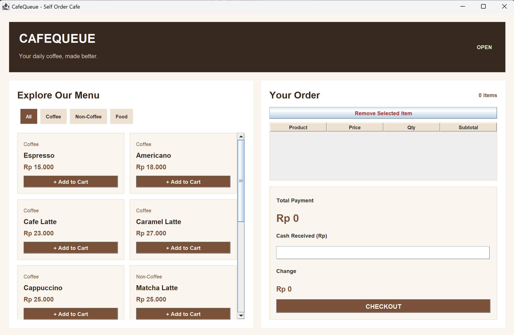
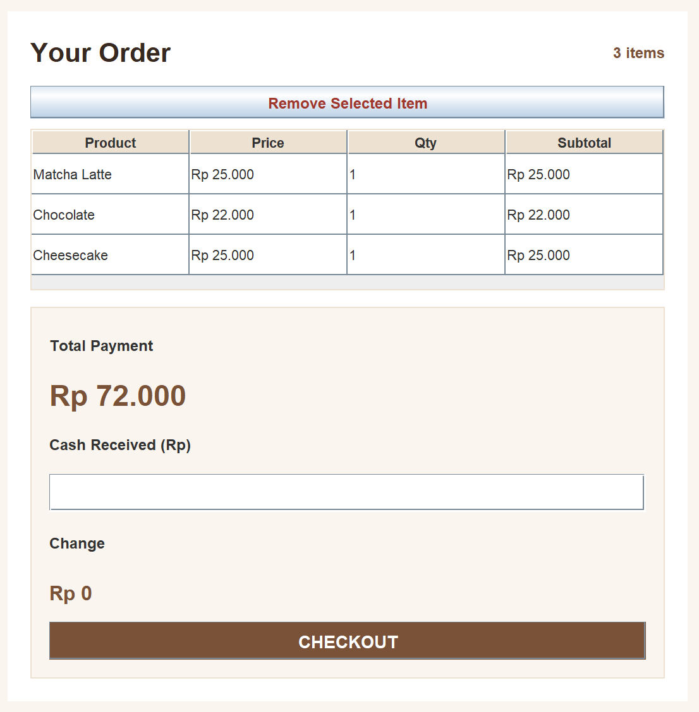
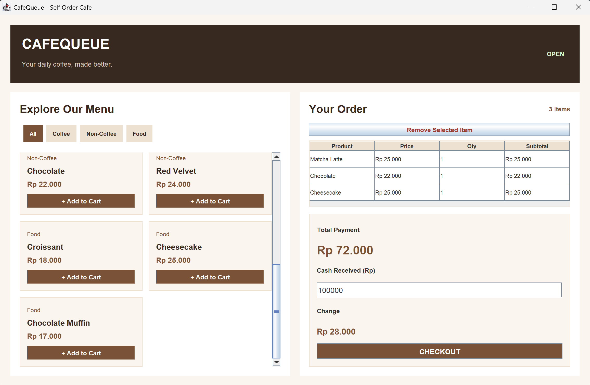
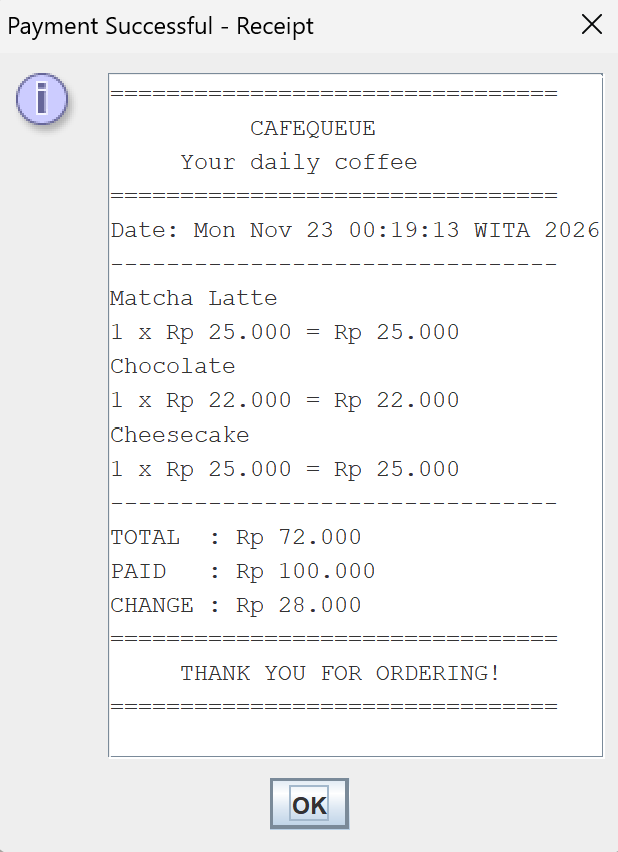

## Nama: Rifdah Asyliyah
## NIM: F1D02410090
## Mata Kuliah: Pemrograman Berorientasi Objek (PBO)


# CafeQueue – Self Order Cafe 

**Your daily coffee, made better.**

## 1. Deskripsi Proyek

CafeQueue merupakan aplikasi desktop berbasis Java Swing yang dikembangkan sebagai sistem pemesanan mandiri (*Self-Order Cafe*).

Aplikasi ini memungkinkan pelanggan memilih produk berdasarkan kategori, menambahkan produk ke keranjang, mengelola pesanan, melakukan pembayaran tunai, menghitung uang kembalian secara otomatis, serta melihat struk transaksi.

Proyek ini dibuat untuk menerapkan materi Graphical User Interface (GUI) pada Java dengan menggunakan komponen Swing, Layout Manager, Event Handling, dan konsep Object-Oriented Programming (OOP).

## 2. Fitur Aplikasi

Beberapa fitur yang tersedia pada CafeQueue:

1. **Product Menu** – Menampilkan daftar produk makanan dan minuman.
2. **Category Filter** – Memfilter produk berdasarkan kategori Coffee, Non-Coffee, dan Food.
3. **Add to Cart** – Menambahkan produk ke dalam keranjang pesanan.
4. **Quantity Management** – Menambah kuantitas secara otomatis ketika produk yang sama dipilih kembali.
5. **Remove Item** – Menghapus produk yang dipilih dari keranjang.
6. **Total Payment** – Menghitung total harga seluruh pesanan secara otomatis.
7. **Cash Payment** – Memasukkan nominal pembayaran tunai.
8. **Automatic Change Calculation** – Menghitung uang kembalian secara otomatis ketika nominal pembayaran berubah.
9. **Checkout** – Memproses transaksi setelah pembayaran mencukupi.
10. **Receipt** – Menampilkan struk transaksi setelah checkout berhasil.

## 3. Teknologi yang Digunakan

| Teknologi | Keterangan |
|---|---|
| Java | Bahasa pemrograman |
| Java Swing | Pembuatan antarmuka GUI |
| Java AWT | Pengaturan layout, warna, dan font |
| ArrayList | Pengelolaan data keranjang |
| ActionListener | Menangani interaksi tombol |
| DocumentListener | Mendeteksi perubahan nominal pembayaran |

## 4. Implementasi Lima Komponen Utama GUI

### A. Top-Level Container

**Class: `JFrame`**

Top-Level Container merupakan container utama yang menjadi tempat peletakan komponen GUI lainnya.

Pada CafeQueue, `JFrame` digunakan melalui class `MainFrame` sebagai jendela utama aplikasi.

Implementasi:

```java
public class MainFrame extends JFrame {

    public MainFrame() {
        setTitle("CafeQueue - Self Order Cafe");
        setSize(1150, 750);
        setDefaultCloseOperation(JFrame.EXIT_ON_CLOSE);
    }
}
```

### B. Intermediate Container

**Class: `JPanel`**

Intermediate Container berfungsi sebagai tempat untuk mengelompokkan komponen GUI.

Pada CafeQueue, `JPanel` digunakan dalam beberapa class, yaitu:

- `MainFrame` untuk mengatur header dan konten utama.
- `MenuPanel` untuk mengelompokkan daftar menu dan kategori.
- `CartPanel` untuk mengelompokkan tabel pesanan dan panel pembayaran.

### C. Atomic Component

**Class: `JButton`, `JLabel`, `JTextField`, `JTable`, dan `JTextArea`**

Atomic Component merupakan komponen GUI yang memiliki fungsi spesifik dan digunakan secara langsung oleh pengguna.

Implementasi pada CafeQueue:

| Komponen | Fungsi |
|---|---|
| `JButton` | Tombol kategori, Add to Cart, Remove Selected Item, dan Checkout. |
| `JLabel` | Menampilkan judul, nama produk, harga, total pembayaran, dan kembalian. |
| `JTextField` | Menerima input nominal pembayaran. |
| `JTable` | Menampilkan daftar produk dalam keranjang pesanan. |
| `JTextArea` | Menampilkan informasi struk transaksi. |

### D. Layout Manager

**Class: `BorderLayout`, `GridLayout`, dan `FlowLayout`**

Layout Manager digunakan untuk mengatur posisi dan susunan komponen GUI di dalam container.

Implementasi pada CafeQueue:

1. **BorderLayout** digunakan untuk membagi area tampilan menjadi NORTH, SOUTH, EAST, WEST, dan CENTER.
2. **GridLayout** digunakan untuk menyusun komponen dalam bentuk baris dan kolom, seperti kartu produk dan panel pembayaran.
3. **FlowLayout** digunakan untuk menyusun tombol kategori menu secara horizontal.

### E. Event Handling

**Interface: `ActionListener` dan `DocumentListener`**

Event Handling berfungsi untuk menangani berbagai interaksi yang dilakukan pengguna terhadap komponen GUI.

Implementasi pada CafeQueue:

- `ActionListener` digunakan untuk menangani aksi tombol seperti memilih kategori, menambahkan produk, menghapus pesanan, dan melakukan checkout.
- `DocumentListener` digunakan untuk mendeteksi perubahan teks pada `JTextField` pembayaran sehingga uang kembalian dapat dihitung secara otomatis.

## 5. Struktur Class dan Penerapan OOP

CafeQueue dikembangkan menggunakan beberapa class dengan tanggung jawab yang berbeda agar program lebih terstruktur dan mudah dikembangkan.

| Class | Tanggung Jawab |
|---|---|
| `CafeQueueApp` | Menjadi titik awal untuk menjalankan aplikasi. |
| `MainFrame` | Mengatur jendela utama dan menghubungkan seluruh panel. |
| `Product` | Menyimpan informasi produk berupa nama, kategori, dan harga. |
| `CartItem` | Menyimpan produk dan jumlah produk dalam pesanan. |
| `Cart` | Mengelola data keranjang, menambah, menghapus, dan menghitung total pesanan. |
| `MenuPanel` | Mengatur tampilan menu, kategori, dan tombol penambahan produk. |
| `CartPanel` | Mengatur tabel pesanan, pembayaran, perhitungan kembalian, dan checkout. |
| `ReceiptDialog` | Membuat dan menampilkan struk transaksi. |

Penerapan konsep OOP pada aplikasi:

- **Encapsulation:** Menggunakan atribut `private` dan method getter untuk mengakses data objek.
- **Class and Object:** Membagi program menjadi beberapa class sesuai tanggung jawabnya.
- **Constructor:** Menginisialisasi objek dan atribut yang diperlukan.
- **Inheritance:** Menggunakan pewarisan class Swing, seperti `MainFrame extends JFrame` dan `MenuPanel extends JPanel`.
- **Polymorphism:** Mengimplementasikan method `actionPerformed()` dari interface `ActionListener` pada event listener.

## 6. Screenshot Aplikasi

### A. Tampilan Utama

Tampilan utama CafeQueue menampilkan header aplikasi, kategori menu, daftar produk, serta keranjang pesanan.



### B. Tampilan Keranjang Pesanan

Tampilan keranjang memperlihatkan produk yang telah dipilih pelanggan, harga produk, kuantitas, subtotal, dan total pembayaran.



### C. Tampilan Pembayaran

Tampilan pembayaran memperlihatkan nominal uang tunai yang dimasukkan pelanggan dan hasil perhitungan uang kembalian secara otomatis.



### D. Tampilan Struk Transaksi

Tampilan struk menunjukkan rincian transaksi setelah checkout berhasil, meliputi daftar produk, kuantitas, subtotal, total pembayaran, uang diterima, dan uang kembalian.


